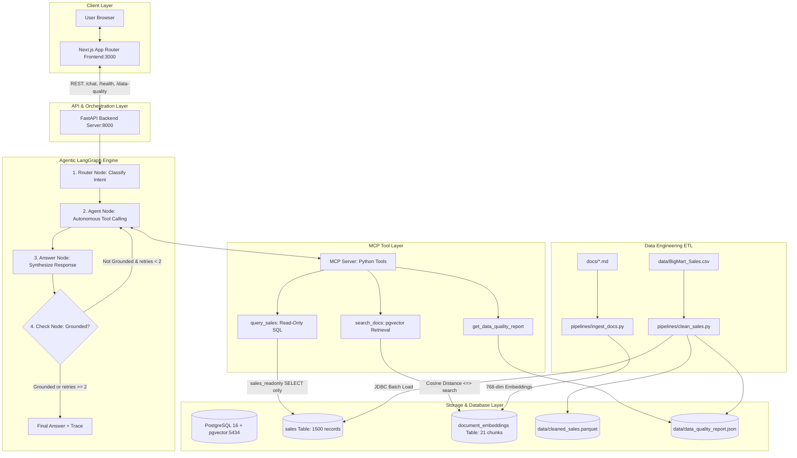
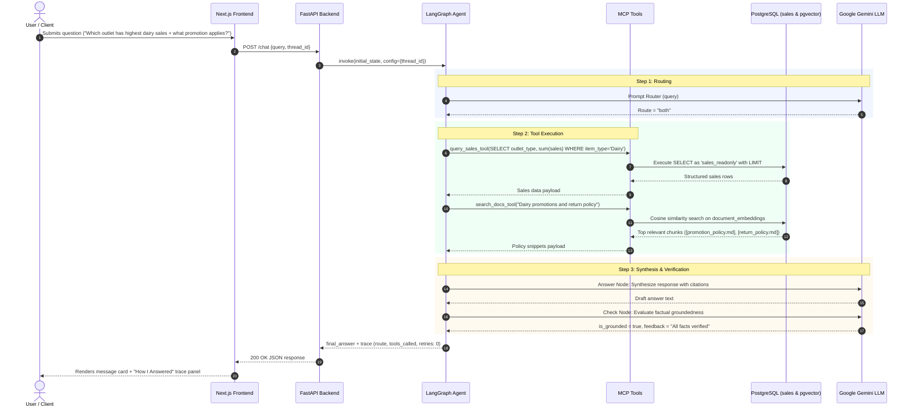
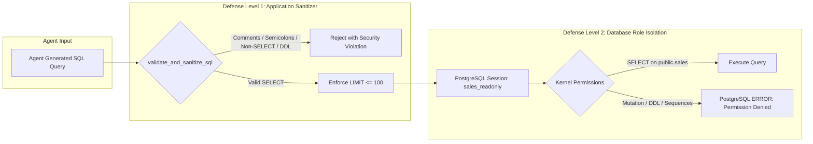
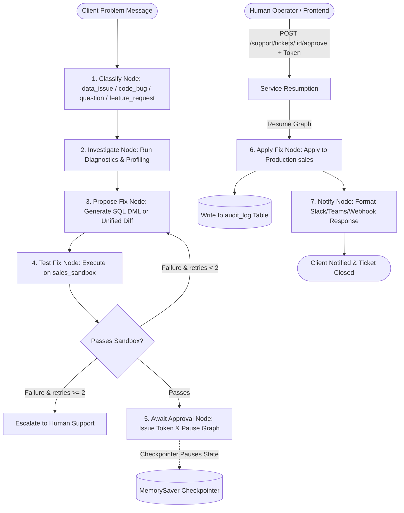
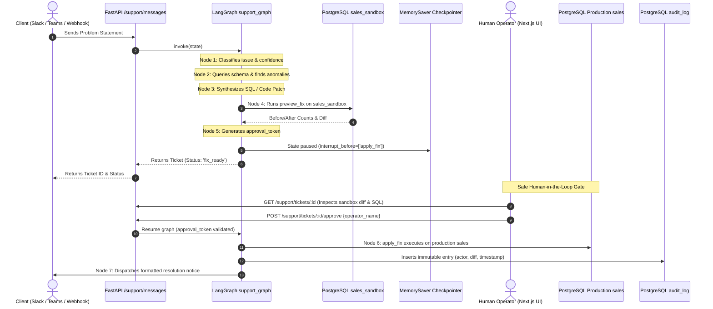

# System Architecture & Technical Specifications (ARCHITECTURE.md)

This document details the complete end-to-end architecture of the **Business Assistant** platform.

---

## 1. System Overview Architecture



---

## 2. Agentic Workflow Sequence Diagram



---

## 3. Security Architecture & Threat Model



### Key Security Controls:
1. **Zero Secret Hardcoding**: All credentials (`GOOGLE_API_KEY`, `DATABASE_URL`, `READONLY_DATABASE_URL`) are read strictly from environment variables.
2. **Read-Only Database Role**: The `sales_readonly` role is explicitly granted `SELECT` privileges only on `sales` and `document_embeddings`. All mutation privileges (`INSERT`, `UPDATE`, `DELETE`, `TRUNCATE`, `DROP`) are permanently revoked at the PostgreSQL catalog level.
3. **Application SQL Sanitizer**: Semicolons, comments, and non-SELECT keywords are stripped and blocked before opening a database connection.
4. **Mandatory Query Pagination**: Queries lacking a `LIMIT` clause automatically have `LIMIT 100` appended to prevent denial-of-service through memory exhaustion.

---

## 4. PySpark Data Cleaning Pipeline Architecture

```
Raw CSV (/data/BigMart_Sales.csv)
  │
  ├──► Initial Profile: 1,530 rows, 30 duplicates, 226 Item_Weight nulls, 621 Outlet_Size nulls
  │
  ├──► Transformation 1: dropDuplicates() [1,530 -> 1,500 rows]
  │
  ├──► Transformation 2: Label Standardization
  │      Item_Fat_Content: ['LF', 'low fat', ' Regular '] -> ['Low Fat', 'Regular']
  │
  ├──► Transformation 3: Window Imputation
  │      Item_Weight: mean(Item_Weight) over (Window.partitionBy('Item_Identifier'))
  │      coalesce with global mean (12.85 kg)
  │
  ├──► Transformation 4: Domain Mode Imputation
  │      Outlet_Size: imputed based on Outlet_Type (Grocery -> Small, Supermarket -> Medium)
  │
  ├──► Transformation 5: Visibility Imputation (0.0 -> item average visibility)
  │
  ├──► Action 1: Export Parquet (data/cleaned_sales.parquet)
  ├──► Action 2: Export Data Quality Audit (data/data_quality_report.json)
  └──► Action 3: JDBC Write to PostgreSQL 'sales' Table
```

---

## 5. RAG Vector Pipeline Architecture

```
Company Markdown Documents (/docs)
  ├── return_policy.md
  ├── faq.md
  ├── promotion_policy.md
  ├── outlet_guidelines.md
  └── pricing_policy.md
         │
         ▼
  Semantic Section Parser (splits by '##' headers)
         │
         ▼
  Sliding Window Chunker (600 characters, 60 char overlap) -> 21 total chunks
         │
         ▼
  Embedding Generator (Gemini text-embedding-004 / 768-dim vector)
         │
         ▼
  PostgreSQL pgvector Table ('document_embeddings')
         │
         ▼
  Cosine Distance Search (<=>) with 1 - (embedding <=> query_vec) as similarity score
```


---

## 6. Autonomous Support Desk & Safe Remediation Architecture

### LangGraph `support_graph` Workflow



### Support Desk Sequence Diagram (Human-in-the-Loop)


