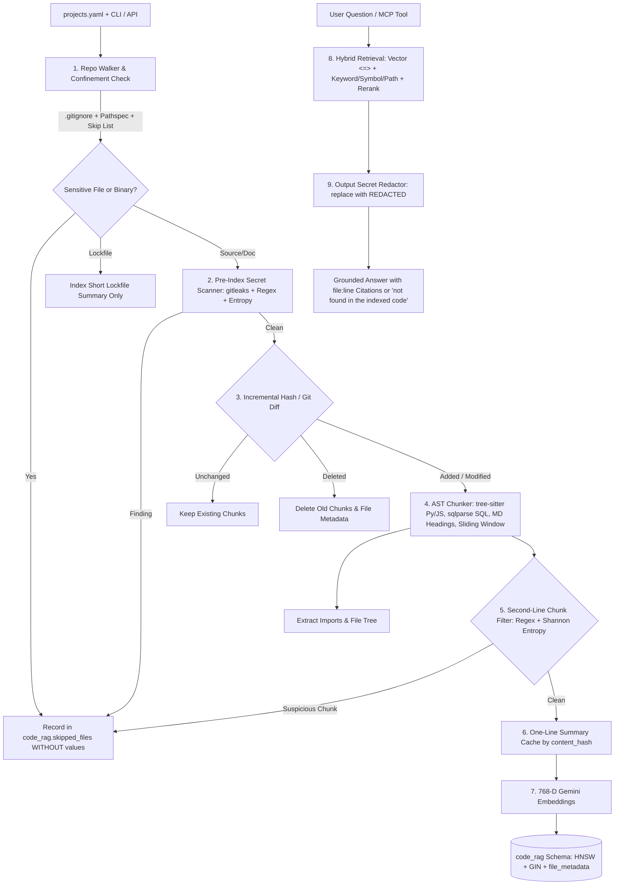

# Phase 1 Design: Project Init (Project-Aware Codebase RAG)

## 1. Overview & Goals

**Project Init** indexes configured git repositories into a dedicated PostgreSQL `code_rag` schema (`pgvector` + full-text/symbol metadata) so engineers and analysts can ask codebase architecture and implementation questions (for example, *"where is the orders API implemented?"* or *"which files import retrieval?"*) and receive grounded answers with exact `file:line` citations — while strictly excluding and redacting secrets at every stage.

---

## 2. Configuration (`projects.yaml`)

Target repositories are declared in `projects.yaml` at the workspace root. Multiple repositories are supported cleanly under the `projects:` array:

```yaml
projects:
  - name: business-assistant
    local_path: .
    default_branch: main
    include:
      - "**/*.py"
      - "**/*.js"
      - "**/*.jsx"
      - "**/*.sql"
      - "**/*.md"
    exclude:
      - "frontend/.next/**"
      - "data/**"
```

---

## 3. Data Model (`code_rag` PostgreSQL Schema)

All tables live in a dedicated schema **`code_rag`**, completely isolated from operational tables in `public` (`sales`, `document_embeddings`, `support_tickets`, etc.).

1. **`code_rag.projects`** — Registry & last index telemetry:
   - `name` (PK), `local_path`, `default_branch`, `last_commit_hash`, `last_indexed_at`, `file_count`, `chunk_count`, `skipped_count`, `status`, `last_error`
2. **`code_rag.file_metadata`** — File tree & structural dependency metadata:
   - `id` (PK), `project` (FK), `file_path`, `language`, `commit_hash`, `content_hash`, `line_count`, `chunk_count`, `imports` (`JSONB` list of imported modules/symbols), `symbols` (`JSONB` list of `{name, kind, start_line, end_line}`), `updated_at`
   - Unique key: `(project, file_path)`
3. **`code_rag.code_chunks`** — Vectorized & keyword-indexed AST chunks:
   - `id` (PK), `chunk_uid` (UNIQUE), `project` (FK), `file_path`, `language`, `symbol_name`, `chunk_kind`, `start_line`, `end_line`, `commit_hash`, `content_hash`, `summary`, `content`, `search_tsv` (stored generated `tsvector`), `embedding` (`VECTOR(768)`), `created_at`
   - Indexes: `HNSW (embedding vector_cosine_ops)`, `GIN (search_tsv)`, `(project, file_path)`, `(project, symbol_name)`
4. **`code_rag.summary_cache`** — Content-addressed summary cache:
   - `content_hash` (PK), `summary`, `created_at`
   - Avoids redundant LLM calls when unchanged chunks shift lines or files are re-processed.
5. **`code_rag.skipped_files`** — Audit report of skipped sensitive/ignored files (never secret values):
   - `id` (PK), `project` (FK), `file_path`, `reason`, `rule`, `scanned_at`

---

## 4. End-to-End Flow & Security Defense-in-Depth



---

## 5. Multi-Layer Security Guarantees

1. **Path Confinement**: Every file read, index, or MCP tool call resolves `os.path.realpath` and rejects anything outside the configured project root.
2. **Hard Mandatory Skip List + `.gitignore`**: `.env`, `.env.*`, `*.pem`, `*.key`, `*.p12`, `*.pfx`, `id_rsa*`, `*.kdbx`, `credentials*`, `secrets*`, `service-account*.json`, `.npmrc` / `.pypirc` containing tokens, `*.tfstate*`, database dumps (`*.sql.gz`, `*.dump`, `*.bak`, `*.sqlite*`, large SQL dump files), `node_modules`, build directories, virtualenvs, binary files, oversized files (>512 KB), and `.git`. Lock files produce a minimal metadata-only summary chunk (`package-lock.json`, `yarn.lock`, `pnpm-lock.yaml`, `poetry.lock`, `uv.lock`, `Cargo.lock`).
3. **Pre-Index File Secret Scanner**: Runs `gitleaks detect --no-git` when installed, combined with a built-in deterministic regex + Shannon entropy scanner. Any matched file is aborted completely before parsing and logged to `skipped_files` (path + rule name only).
4. **Chunk-Level Regex + Entropy Gate**: Every individual chunk is checked again before embedding/insertion; suspicious chunks (API keys, private keys, JWTs, high-entropy assignments/connection strings) are dropped and audited.
5. **Output Redaction Filter**: Every retrieved snippet, MCP response, and LLM answer passes through `redact_secrets()`, replacing any secret-looking string with `[REDACTED]`.

---

## 6. Interfaces

- **CLI**:
  - `project-init index <name>` (full or incremental index)
  - `project-init reindex <name>` (incremental via `git diff` + content hash; optional `--full`)
  - `project-init index <name> --watch` (live incremental re-index on file changes via `watchdog`)
- **MCP Tools (`mcp_server/server.py`, read-only)**:
  - `list_projects`
  - `search_code`
  - `get_file_outline`
  - `find_symbol`
- **FastAPI Endpoints (`backend/main.py`)**:
  - `GET /projects`
  - `GET /projects/{name}/index-status`
  - `GET /projects/{name}/skipped`
  - `POST /projects/{name}/ask`
  - `POST /projects/{name}/index`
- **Frontend (`05 Projects` Tab)**:
  - Displays indexed projects, commit SHA, real file/chunk counts, skipped files table (names + reasons only), re-index action, and codebase Q&A with clickable `file:line` citations and inline snippet inspection.
