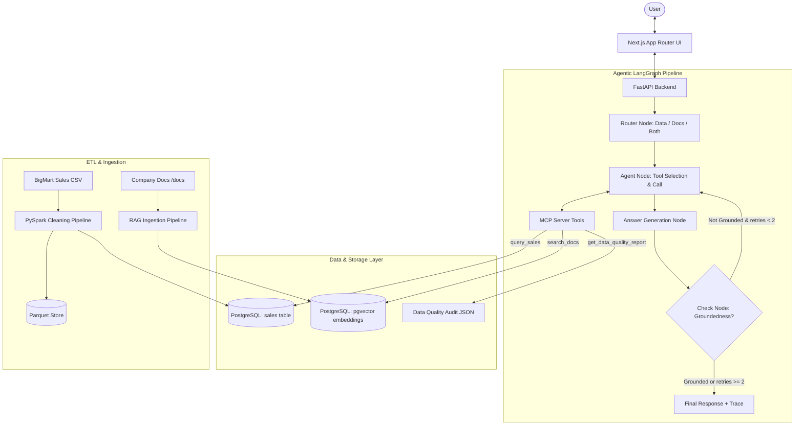

# Implementation Plan: "Business Assistant" (Chat with your Data + Documents)

## Executive Summary
"Business Assistant" is an end-to-end enterprise-grade conversational AI platform that bridges structured enterprise sales data and unstructured company policies/documentation. Users ask questions in natural language, and an autonomous LangGraph agent determines whether the request requires querying the sales database via read-only SQL, retrieving company knowledge via pgvector-powered RAG, or synthesizing both sources.

## Core Capabilities
1. **PySpark Data Transformation**: Ingestion, quality auditing, schema standardization, and JDBC persistence of BigMart sales data into PostgreSQL.
2. **Hybrid RAG & pgvector Store**: Intelligent document chunking, semantic vector embeddings, and similarity search over company policies.
3. **Secure Model Context Protocol (MCP)**: Strict read-only SQL execution (`query_sales`), semantic retrieval (`search_docs`), and audit reporting (`get_data_quality_report`).
4. **LangGraph Agentic Architecture**: Router -> Agent -> Answer -> Groundedness Evaluator with stateful checkpointer memory and a 2-retry cap.
5. **FastAPI & Next.js Experience**: Asynchronous REST API paired with a responsive Next.js Tailwind interface featuring an interactive "How I Answered" trace drawer and data quality dashboard.
6. **Cloud-Native Deployment**: Production-grade Docker Compose, container specifications, and comprehensive GCP & AWS deployment blueprints.

---

## Technical Architecture & Flow

---

## Phased Implementation Roadmap

### Stage 0: Foundations & Environment Verification
- [x] Environment inspection: Python, Java, Docker, Node, Postgres ports.
- [x] Write `PLAN.md`, `TASKS.md`, `DECISIONS.md`, and `.env.example`.
- [x] Document system constraints (port 5434 for Postgres container, Java 21 compatibility).

### Stage 1: Infrastructure & Database Initialization
- [ ] Create `infra/docker-compose.yml` with `pgvector/pgvector:pg16` mapping port `5434:5432`.
- [ ] Create `infra/init.sql` for database schema: `sales` table, `document_embeddings` table with vector support, and `sales_readonly` security role with scoped permissions.
- [ ] Start Docker Compose database and verify health and extension loading.

### Stage 2: PySpark Sales Data Pipeline & Quality Auditing
- [ ] Create synthetic BigMart sales generator in `pipelines/generate_data.py` if CSV absent.
- [ ] Implement PySpark job in `pipelines/clean_sales.py`:
  - Infer & enforce types.
  - Profile data before transformation.
  - Impute missing `Item_Weight` and `Outlet_Size`.
  - Standardize messy categorical labels (e.g. `LF`/`low fat` -> `Low Fat`, `reg` -> `Regular`).
  - Drop duplicate rows and strip string columns.
  - Export data quality metrics to `data/data_quality_report.json`.
  - Save Parquet to `data/cleaned_sales.parquet`.
  - Persist into PostgreSQL `sales` table via JDBC / driver.

### Stage 3: RAG Ingestion & Vector Retrieval
- [ ] Populate `/docs` with realistic company policies:
  - `return_policy.md`
  - `faq.md`
  - `promotion_policy.md`
  - `outlet_guidelines.md`
  - `pricing_policy.md`
- [ ] Build chunking and embedding pipeline in `pipelines/ingest_docs.py` using Gemini / mock embedding fallback.
- [ ] Build standalone retrieval module with cosine similarity and source attribution.

### Stage 4: Model Context Protocol (MCP) Server
- [ ] Implement `mcp_server/tools.py` and `mcp_server/server.py`:
  - `query_sales`: Enforce single SELECT statement, reject write/DDL keywords, enforce LIMIT <= 100, execute as `sales_readonly`.
  - `search_docs`: Query pgvector store, return top-k matches with source metadata.
  - `get_data_quality_report`: Read and return PySpark audit metrics.

### Stage 5: LangChain & LangGraph Autonomous Agent
- [ ] Define LangGraph state schema: query, messages, route, tools_used, sources, retry_count, feedback, answer.
- [ ] Implement graph nodes:
  - `router`: Classifies intent into `data`, `docs`, or `both`.
  - `agent`: Invokes tools based on routing and context.
  - `answer`: Synthesizes final response with grounded citations.
  - `check`: Evaluates factual groundedness against tool outputs.
- [ ] Implement conditional loop edge (retry cap = 2).
- [ ] Attach `MemorySaver` checkpointer for thread-based conversation memory.

### Stage 6: FastAPI Backend
- [ ] Implement REST endpoints:
  - `GET /health`: Comprehensive database and service health checks.
  - `POST /chat`: Execute LangGraph agent, stream or return response, trace, tools used, and sources.
  - `GET /data-quality`: Serve PySpark data audit report.
  - `GET /sources`: Return indexed documents and metadata.
- [ ] Configure CORS, logging, and graceful error handling.

### Stage 7: Next.js + Tailwind CSS Frontend
- [ ] Initialize Next.js App Router application using JavaScript (`.jsx`) and Tailwind CSS.
- [ ] Build chat interface with user/assistant message bubbles and loading indicators.
- [ ] Build interactive "How I Answered" panel displaying route, tools called, retries, and source snippets.
- [ ] Add 5 preset sample query buttons.
- [ ] Add Data Quality modal/tab visualizing ETL metrics.

### Stage 8: Cloud Deployment Specifications
- [ ] Create `infra/Dockerfile.backend` (Python 3.11-slim) and `infra/Dockerfile.frontend` (Node multi-stage).
- [ ] Author `infra/DEPLOY_GCP.md` / `docs/DEPLOY_GCP.md` (Cloud Run, Cloud SQL, Vertex AI).
- [ ] Author `infra/DEPLOY_AWS.md` / `docs/DEPLOY_AWS.md` (ECS/Fargate, RDS pgvector, Bedrock).
- [ ] Include detailed architectural mapping tables for both clouds.

### Stage 9: Automated Testing & Verification
- [ ] Unit tests for SQL injection prevention and LIMIT enforcement (`test_sql_safety.py`).
- [ ] Unit tests for router classification logic (`test_router.py`).
- [ ] Unit tests for retry loop termination at 2 retries (`test_retry_cap.py`).
- [ ] Unit tests for RAG chunking and vector retrieval (`test_rag.py`).
- [ ] Integration tests for FastAPI endpoints (`test_api.py`).
- [ ] Verify production frontend build (`npm run build`).

### Stage 10: Comprehensive Documentation & Educational Guides
- [ ] `README.md`: Quickstart, configuration, architecture overview, sample questions.
- [ ] `ARCHITECTURE.md`: Deep dive with Mermaid architectural diagrams.
- [ ] `EXPLAIN.md`: Beginner-friendly conceptual guide with real-life analogies.
- [ ] `INTERVIEW_QA.md`: 25 senior engineering manager Q&As across all tech stack areas.
- [ ] `BLOCKED.md`: Action items for user (e.g. setting `GOOGLE_API_KEY`).
