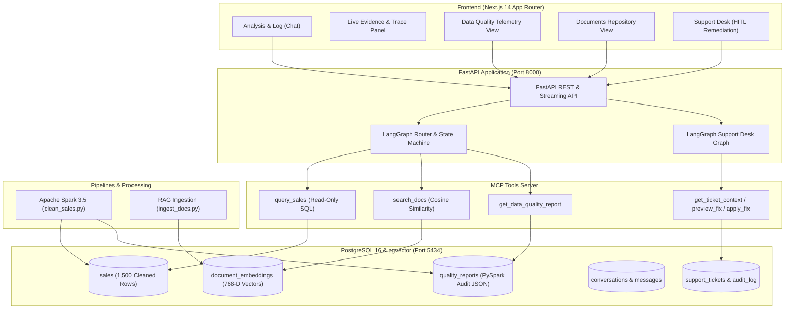

# Business Assistant — Complete User & Operator Guide

The **Business Assistant** is an enterprise-grade autonomous analyst workbench powered by FastAPI, LangGraph, Model Context Protocol (MCP), PySpark, and PostgreSQL with `pgvector`, paired with a Next.js App Router frontend.

---

## 1. Prerequisites

Before starting, ensure your system has the following installed:

| Requirement | Minimum Version | Verification Command | Notes |
| :--- | :--- | :--- | :--- |
| **Docker & Docker Compose** | 24.0+ | `docker compose version` | Hosts PostgreSQL 16 with pgvector |
| **Python** | 3.11 or 3.12 | `python3 --version` | Runs backend, pipelines, & MCP |
| **Node.js & npm** | Node 18+ / npm 9+ | `node -v && npm -v` | Builds and serves Next.js frontend |
| **Java Runtime (JRE)** | Java 8, 11, or 17 | `java -version` | Required by Apache Spark 3.5.x |
| **Google Gemini API Key** | — | `echo $GEMINI_API_KEY` | Powers LLM reasoning & vector embeddings |

> [!TIP]
> If Java is not installed on Ubuntu/Debian, install it with:
> ```bash
> sudo apt update && sudo apt install -y default-jre
> ```

---

## 2. Environment Setup

Create a `.env` file in the project root directory. You can copy the template:

```bash
cp .env.example .env
```

Here is the complete reference of environment variables:

```bash
# =====================================================================
# Database Configuration (PostgreSQL 16 + pgvector)
# =====================================================================
POSTGRES_HOST=localhost
POSTGRES_PORT=5434                # Port 5434 is used to prevent collisions with local Postgres
POSTGRES_DB=business_assistant
POSTGRES_USER=postgres
POSTGRES_PASSWORD=postgres

# Read-only user used for safe SQL query execution by the agent
POSTGRES_READONLY_USER=sales_readonly
POSTGRES_READONLY_PASSWORD=readonly_password

# =====================================================================
# Artificial Intelligence & LLM Settings
# =====================================================================
GEMINI_API_KEY=your_gemini_api_key_here
GEMINI_MODEL=gemini-3-flash
EMBEDDING_MODEL=text-embedding-004

# =====================================================================
# Backend & Frontend Connectivity
# =====================================================================
API_HOST=0.0.0.0
API_PORT=8000
NEXT_PUBLIC_API_URL=http://localhost:8000
```

---

## 3. One-Command Startup

To initialize the database, execute the PySpark data cleaning pipeline, ingest policy documents, and verify system health in a single command, run:

```bash
make setup
```

*Or execute the setup script directly:*

```bash
chmod +x ./scripts/setup.sh
./scripts/setup.sh
```

What `make setup` does:
1. Validates prerequisites (Docker, Python, Node, Java).
2. Sets up Python virtual environment (`.venv`) and installs dependencies (`requirements.txt`).
3. Starts the PostgreSQL container on port `5434`.
4. Applies schema migrations (`infra/init.sql`).
5. Executes the PySpark ETL pipeline (`pipelines/clean_sales.py`), loading 1,500 cleaned records and recording telemetry into `quality_reports`.
6. Vectorizes SOP documents into 768-D embeddings (`pipelines/ingest_docs.py`).
7. Installs frontend dependencies in `/frontend`.

---

## 4. Manual Startup Step-by-Step

If you prefer running services individually in separate terminals:

### Step 4.1: Start PostgreSQL with pgvector
```bash
docker compose -f infra/docker-compose.yml up -d
```
Verify the container is healthy:
```bash
docker compose -f infra/docker-compose.yml ps
```

### Step 4.2: Run the PySpark Sales Cleaning Pipeline
```bash
source .venv/bin/activate
python -m pipelines.clean_sales
```
This reads `data/Train.csv`, imputes missing weights and outlet sizes, standardizes category labels, creates the `sales` table, and logs audit metrics into `quality_reports`.

### Step 4.3: Ingest Policy Documents into pgvector
```bash
source .venv/bin/activate
python -m pipelines.ingest_docs
```
This chunks all markdown and text files in `docs/`, generates 768-dimensional embeddings, and builds the HNSW index in PostgreSQL.

### Step 4.4: Start the FastAPI Backend
```bash
source .venv/bin/activate
uvicorn backend.main:app --host 0.0.0.0 --port 8000 --reload
```
Test that the backend is healthy:
```bash
curl -s http://localhost:8000/status | jq .
```

### Step 4.5: Start the Next.js Frontend
```bash
cd frontend
npm install
npm run build
npm run start
```
The application will be live at [http://localhost:3000](http://localhost:3000).

---

## 5. How to Use Each View

### 5.1 Analysis & Log (Main Chat)
- **Natural Language Querying**: Type any business question into the composer (e.g., *"What are the top 5 item types by total outlet sales?"* or *"What is our policy on returning perishable items?"*).
- **Autonomous Routing**: The LangGraph router inspects query intent and routes to:
  - `DATA`: Generates parameterized read-only SQL executed against PostgreSQL `sales`.
  - `DOCS`: Performs cosine similarity semantic search across vectorized policies.
  - `BOTH`: Synthesizes quantitative SQL metrics with qualitative SOP guidelines.
- **Evidence Panel**: The right drawer opens automatically to inspect:
  - Exact SQL query generated and executed.
  - Tabular SQL execution results with row counts.
  - Vector similarity scores and policy source chunks with inline citations (`[1]`, `[2]`).
  - Execution latency, router classification confidence, and full LangGraph execution trace.

### 5.2 Data Quality (ETL & Schema Telemetry)
- Navigate via the sidebar tab: **Data Quality (ETL)**.
- Inspect the **Global Health Index** (96% Optimal) computed directly from the PySpark cleaning run.
- Review **Delta Convergence**:
  - `Item_Weight`: 226 raw missing imputed with item-mean weights (0 remaining).
  - `Outlet_Size`: 621 raw missing imputed with mode tiers (0 remaining).
  - Categorical standardization: 5 noisy classes (`low fat`, `LF`, `reg`) consolidated into 2 canonical classes (`Low Fat`, `Regular`).
- View the **Automated Invariant Verification Table** checking non-negative sales, valid MRP ranges, and schema integrity.

### 5.3 Document Knowledge Repository
- Navigate via the sidebar tab: **Documents (DOCS)**.
- Browse all 5 indexed operational documents (`faq.md`, `outlet_guidelines.md`, `pricing_policy.md`, `promotion_policy.md`, `return_policy.md`).
- Inspect vector metrics: 21 HNSW vector chunks with **768-D** embeddings.
- Filter documents with real-time search.
- Click **"Ask Question"** on any document card to automatically execute a grounded query against that SOP.

### 5.4 Support Desk (Autonomous Remediation)
- Navigate via the sidebar tab: **Support Desk**.
- Review client-reported issues triaged by the `support_graph`.
- **Simulate Client Ticket**: Click `+ Simulate Client` to submit a sample issue (e.g., *"Low Fat and LF show as separate categories in the report"*).
- **Autonomous Investigation**: The agent investigates root cause, computes a patch, tests it inside an isolated sandbox table, and shows a before/after diff.
- **Human-in-the-Loop (HITL) Gate**: Production modifications are blocked until a human clicks **"Approve & Apply Fix"**, which verifies the approval token, commits the change, and writes to `audit_log`.

---

## 6. How to Add New Company Documents

The RAG ingestion pipeline dynamically indexes any document placed in the `/docs` directory without code changes:

1. Add your `.md` or `.txt` file to the `docs/` folder:
   ```bash
   cp ~/Downloads/shipping_guidelines.md docs/shipping_guidelines.md
   ```
2. Run the ingestion pipeline:
   ```bash
   python -m pipelines.ingest_docs
   ```
3. Re-open the **Documents** tab in the browser or click **"Refresh Docs"**:
   - The document count will automatically increment.
   - New chunks are indexed with 768-D embeddings and immediately searchable by the agent.

---

## 7. How to Run Tests

### Run Full Backend & Guardrail Test Suite:
```bash
pytest tests/ -v
```
This runs 54 automated integration tests, including:
- `tests/test_zero_mock_guardrails.py`: Enforces zero hardcoded/mock data across production code and verifies that all endpoints return live database records.
- `tests/test_sql_safety.py`: Confirms read-only constraints, rejects mutations (`DROP`, `INSERT`, `UPDATE`), and enforces limits.
- `tests/test_retry_cap.py`: Asserts LangGraph state machine bounds and retry caps.
- `tests/test_support_desk.py`: Validates HITL approval tokens, sandbox dry-runs, and audit logging.

### Run Frontend Linter and Production Build:
```bash
cd frontend
npm run lint
npm run build
```
Target: 0 errors, 0 warnings.

---

## 8. Troubleshooting Guide

| Issue | Root Cause | Solution |
| :--- | :--- | :--- |
| **`connection to server at "localhost", port 5432 failed`** | Application defaults to port 5434 to avoid conflicts with existing Postgres | Ensure `.env` has `POSTGRES_PORT=5434` and Docker container is running (`docker compose -f infra/docker-compose.yml up -d`). |
| **`type "vector" does not exist`** | pgvector extension is not initialized | Run: `docker exec -it business_assistant_postgres psql -U postgres -d business_assistant -c "CREATE EXTENSION IF NOT EXISTS vector;"` |
| **`PySpark: Java not found`** | Java Runtime is missing on the system | Install OpenJDK: `sudo apt install -y default-jre` and verify with `java -version`. |
| **`GEMINI_API_KEY is not set`** | Missing Gemini API key in `.env` | Add key to `.env`. Note: The system includes a deterministic normalized vector fallback generator for offline testing. |
| **Frontend displays connection banner** | Backend server is not running on port 8000 | Start backend: `uvicorn backend.main:app --host 0.0.0.0 --port 8000` and click "Retry". |

---

## 9. Architecture Overview


